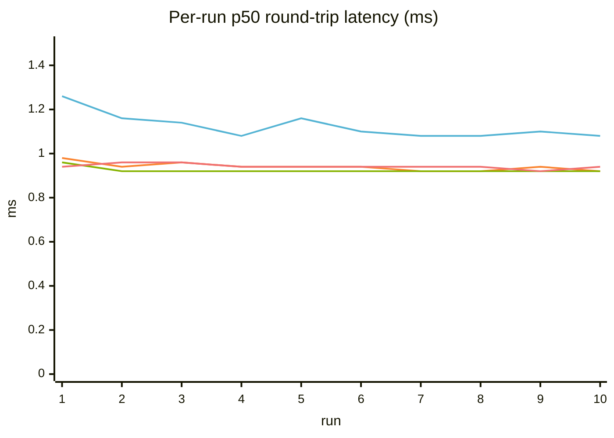
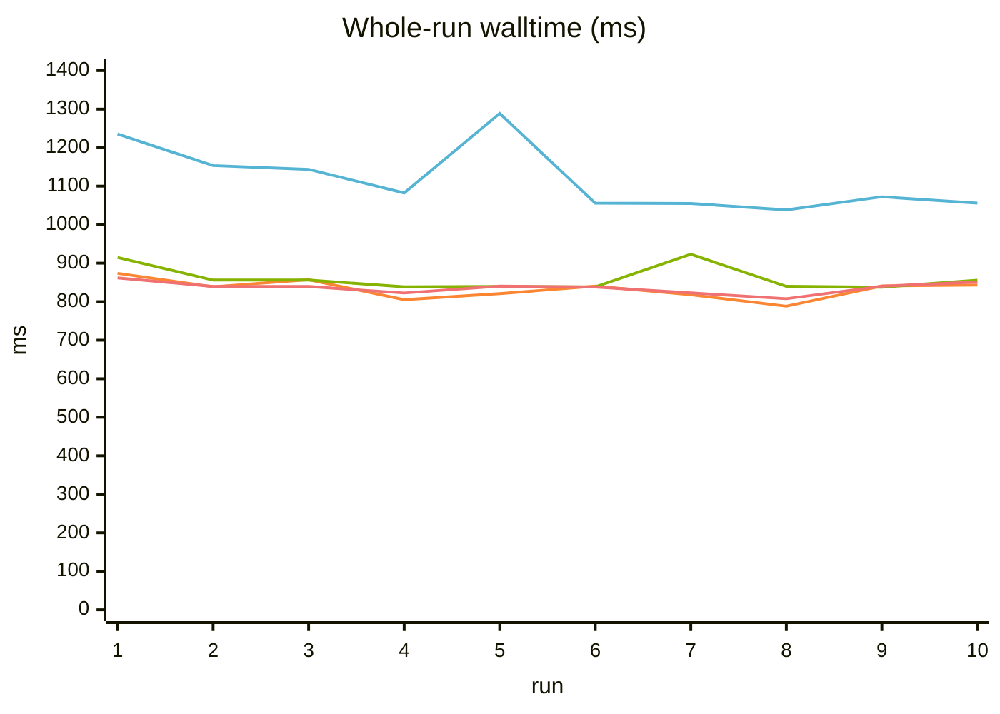

# FF-WebHID Benchmark Report

## Automated image-pipeline benchmark

A Playwright end-to-end benchmark measures Firefox with four data planes: Native Messaging (NM), worker WebSocket (WS), worker WebTransport (WT), and `wt-inpage`, a benchmark-only WT configuration (`dataPlane: 'wt'`, `useWorker: false`). The in-page variant moves transport handling and parsing to page MAIN and is hidden from normal settings. It receives the derived transport authentication value, not the daemon Session bearer token.

**Scenario:** the page fetches `tests/fixtures/images/sample.png` (~32 KB), splits it into 62-byte payloads with 2-byte sequence headers, and sends ~520 `sendReport(1, chunk)` calls with acknowledgement wait. A streaming mock HID relay echoes each report back as input while the page is still sending. Incoming chunks trigger progressive row-slice repaints; image decode (`createImageBitmap`) also runs inside the measured window.

The whole-run metric is `performance.measure('roundtrip', 'send-start', 'image-painted')`. Each run records per-report send-to-input latency (min/p50/p90/p95/max) and full pipeline walltime. The suite also measures device **open**, **warmup** (including failed attempts before warmup succeeds), and **total** startup time (open through run #1 send-start). Each mode runs in a fresh Firefox/profile/daemon/grant environment, without mid-session mode switches.

The relay adds an artificial mock stdout → test script → mock stdin hop. Report and walltime measurements include addon processing, mock relay, serialized sending, page decode, and painting; they are **not** isolated transport or physical-HID latency measurements.

```sh
npm run test:benchmark
```

The `firefox-benchmark` Playwright project uses `daemonMode: 'daemon-nm'` and separate specs for each mode. It disables `privacy.reduceTimerPrecision` for high-resolution `performance.now()`. Settings are written before page load. Each mode performs one unmeasured warmup and an awaited 96-report priming burst before 10 measured runs. Failed/timed-out runs are retried instead of counted. `BENCHMARK_RUNS` overrides the project's `benchmarkRuns` option (10 by default); summary percentiles use nearest rank.

## Current CI snapshot

**Source:** [GitHub Actions run 42198945168, attempt 2](https://github.com/OpenPolyfill/WebHID/actions/runs/42198945168/attempts/2), commit [`28e62d7`](https://github.com/OpenPolyfill/WebHID/commit/28e62d7), Firefox on Ubuntu 24.04 GitHub Actions runner, 10 measured runs per mode.

The per-report values below use the **lower median** (nearest-rank p50) of the ten per-run values for that statistic, including `min`. Walltime summary statistics use the ten full-run durations. Each mode's open/warmup/total come from its CI setup measurement.

| Mode | Open (ms) | Warmup (ms) | Total (ms) | Median per-run min (ms) | Median per-run p50 (ms) | Walltime p50 (ms) |
| --- | ---: | ---: | ---: | ---: | ---: | ---: |
| nm | 9.8 | 254.0 | 267.6 | 0.88 | 1.10 | 1072.3 |
| ws | 48.3 | 184.0 | 235.7 | 0.74 | 0.94 | 838.7 |
| wt-inpage (benchmark only) | 22.7 | 181.0 | 207.3 | 0.70 | 0.92 | 839.8 |
| wt | 35.3 | 179.0 | 217.0 | 0.76 | 0.94 | 839.3 |

### Init time by mode

<!-- Mermaid xychart has no true stacked bars. Its "open + warmup"
     values are cumulative solely for stacked visualization. The table
     above contains actual, non-cumulative measurements. -->

```mermaid
---
config:
  themeVariables:
    xyChart:
      plotColorPalette: '#ADAEB1, #fa8532, #55b4d4'
---
xychart
    title "Init time by mode (ms)"
    x-axis [nm, ws, wt-inpage, wt]
    y-axis "ms" 0 --> 300
    bar "total" [267.6, 235.7, 207.3, 217.0]
    bar "open + warmup" [263.8, 232.3, 203.7, 214.3]
    bar "open" [9.8, 48.3, 22.7, 35.3]
```



### Per-run charts

The four lines, in series order, are `nm`, `ws`, `wt-inpage`, and `wt`.





### Whole-run walltime distribution

| Mode | Runs | Min (ms) | p50 (ms) | p90 (ms) | p95 (ms) | Max (ms) |
| --- | ---: | ---: | ---: | ---: | ---: | ---: |
| nm | 10 | 1038.3 | 1072.3 | 1234.4 | 1288.8 | 1288.8 |
| ws | 10 | 788.3 | 838.7 | 856.9 | 873.5 | 873.5 |
| wt-inpage | 10 | 837.6 | 839.8 | 914.8 | 923.0 | 923.0 |
| wt | 10 | 807.6 | 839.3 | 851.2 | 861.7 | 861.7 |

### Complete per-run results

All latencies and walltimes are in milliseconds. Summary values may differ by 0.1 ms from rounded per-run rows because the runner summarizes unrounded durations.

**NM (optimized direct path)**

| Run | Min | p50 | p90 | p95 | Max | Walltime |
| ---: | ---: | ---: | ---: | ---: | ---: | ---: |
| #1 | 1.00 | 1.26 | 1.98 | 2.68 | 17.96 | 1235.5 |
| #2 | 0.96 | 1.16 | 1.58 | 2.22 | 34.00 | 1153.4 |
| #3 | 0.90 | 1.14 | 1.64 | 2.28 | 29.96 | 1143.6 |
| #4 | 0.86 | 1.08 | 1.48 | 2.10 | 13.96 | 1082.3 |
| #5 | 0.88 | 1.16 | 2.26 | 3.56 | 27.22 | 1288.9 |
| #6 | 0.84 | 1.10 | 1.46 | 1.76 | 6.44 | 1055.7 |
| #7 | 0.88 | 1.08 | 1.54 | 2.20 | 28.00 | 1055.1 |
| #8 | 0.84 | 1.08 | 1.46 | 1.98 | 24.88 | 1038.3 |
| #9 | 0.90 | 1.10 | 1.62 | 2.22 | 6.44 | 1072.3 |
| #10 | 0.90 | 1.08 | 1.44 | 1.74 | 27.70 | 1055.8 |

**WS worker**

| Run | Min | p50 | p90 | p95 | Max | Walltime |
| ---: | ---: | ---: | ---: | ---: | ---: | ---: |
| #1 | 0.76 | 0.98 | 1.48 | 1.68 | 4.12 | 873.6 |
| #2 | 0.76 | 0.94 | 1.36 | 1.64 | 4.20 | 838.8 |
| #3 | 0.78 | 0.96 | 1.38 | 1.60 | 18.00 | 857.0 |
| #4 | 0.72 | 0.94 | 1.44 | 1.58 | 4.86 | 805.3 |
| #5 | 0.74 | 0.94 | 1.50 | 1.68 | 5.18 | 820.9 |
| #6 | 0.76 | 0.94 | 1.44 | 1.62 | 12.28 | 840.3 |
| #7 | 0.72 | 0.92 | 1.36 | 1.64 | 4.60 | 817.9 |
| #8 | 0.74 | 0.92 | 1.32 | 1.52 | 4.38 | 788.3 |
| #9 | 0.74 | 0.94 | 1.48 | 1.64 | 8.28 | 840.8 |
| #10 | 0.76 | 0.92 | 1.44 | 1.56 | 4.52 | 843.2 |

**WT in-page (benchmark only)**

| Run | Min | p50 | p90 | p95 | Max | Walltime |
| ---: | ---: | ---: | ---: | ---: | ---: | ---: |
| #1 | 0.74 | 0.96 | 1.22 | 1.44 | 8.52 | 914.9 |
| #2 | 0.70 | 0.92 | 1.24 | 1.40 | 5.40 | 856.0 |
| #3 | 0.70 | 0.92 | 1.28 | 1.50 | 5.84 | 856.3 |
| #4 | 0.70 | 0.92 | 1.24 | 1.34 | 2.70 | 838.4 |
| #5 | 0.66 | 0.92 | 1.22 | 1.32 | 6.22 | 839.5 |
| #6 | 0.70 | 0.92 | 1.22 | 1.36 | 6.66 | 838.3 |
| #7 | 0.64 | 0.92 | 1.26 | 1.58 | 11.74 | 923.0 |
| #8 | 0.70 | 0.92 | 1.20 | 1.30 | 6.28 | 839.8 |
| #9 | 0.66 | 0.92 | 1.20 | 1.36 | 6.18 | 837.6 |
| #10 | 0.66 | 0.92 | 1.22 | 1.44 | 3.38 | 855.8 |

**WT worker**

| Run | Min | p50 | p90 | p95 | Max | Walltime |
| ---: | ---: | ---: | ---: | ---: | ---: | ---: |
| #1 | 0.78 | 0.94 | 1.20 | 1.54 | 2.96 | 861.7 |
| #2 | 0.76 | 0.96 | 1.26 | 1.54 | 3.58 | 839.4 |
| #3 | 0.76 | 0.96 | 1.30 | 1.58 | 4.42 | 839.3 |
| #4 | 0.74 | 0.94 | 1.20 | 1.46 | 3.86 | 822.6 |
| #5 | 0.74 | 0.94 | 1.22 | 1.52 | 9.80 | 840.2 |
| #6 | 0.76 | 0.94 | 1.30 | 1.58 | 19.44 | 837.9 |
| #7 | 0.76 | 0.94 | 1.32 | 1.52 | 5.68 | 822.8 |
| #8 | 0.76 | 0.94 | 1.30 | 1.52 | 5.48 | 807.7 |
| #9 | 0.74 | 0.92 | 1.32 | 1.64 | 17.48 | 840.2 |
| #10 | 0.76 | 0.94 | 1.20 | 1.44 | 5.96 | 851.2 |

### Reading this snapshot

- NM's per-report p50 is **1.10 ms**, versus **0.94 ms** for WS and worker WT and **0.92 ms** for benchmark-only in-page WT. NM's median per-run minimum is sub-millisecond (**0.88 ms**).
- NM whole-run p50 is **1072.3 ms**, versus **838.7 ms** for WS, **839.3 ms** for worker WT, and **839.8 ms** for in-page WT. NM remains slower in this run, but its full pipeline time is about 28% above worker WS.
- `wt-inpage` remains benchmark-only. Browser scheduling, page rendering, the mock relay, and shared CI runner load affect each recorded run.

## Input-report loss benchmark (8000Hz, render-saturated page)

The image-pipeline benchmark is not a high-rate loss test. The separate `tests/benchmark/loss/` suite (project `firefox-benchmark-loss`) tests delivery at 8000Hz with 6000 reports per run, covering `nm`, `ws`, worker `wt`, and benchmark-only `wt-inpage`. The page main thread runs fixed per-frame compute and canvas work. Each run prints received/lost/loss%/gaps/maxGap/firstGap; `BENCHMARK_LOSS_RATE` and `BENCHMARK_LOSS_COUNT` override its defaults.

```sh
npm run test:benchmark:loss
```

The WS sender in `crates/webhid-daemon/src/batching.rs` uses rate-gated batching: at 12 reports per 4 ms window, the coalesce window expands to 8 ms. Sparse traffic retains the 25µs path. See `AGENTS.md` for the design record. This methodology is separate from the image-pipeline snapshot above.

## Profiling benchmark runs (Gecko profiler via RDP)

Each benchmark spec can capture a Gecko profile around the measured window through the harness's Remote Debugging Protocol connection. No additional browser flags are needed; the capture starts/stops the profiler around `runBenchmark`.

```sh
BENCHMARK_PROFILE_DIR=/tmp/profiles npm run test:benchmark
```

With `BENCHMARK_PROFILE_DIR` set, each spec writes `<dir>/profile-<mode>[-inpage].json` (Firefox Profiler JSON; `loss-<mode>.json` for the loss project) and prints a `[profiler] saved ...` line. The capture adds approximately 1-4 seconds per spec for profile compression.

| Environment variable | Default | Meaning |
| --- | --- | --- |
| `BENCHMARK_PROFILE_FEATURES` | `js,stackwalk,ipcmessages,cpu,cpuallthreads` | Comma-separated profiler features |
| `BENCHMARK_PROFILE_THREADS` | `GeckoMain,Worker` | Comma-separated thread filters |
| `BENCHMARK_PROFILE_ENTRIES` | `268435456` | Per-process buffer size in bytes |
| `BENCHMARK_PROFILE_INTERVAL` | `1` | Sampling interval in ms |

- Firefox Profiler puts child processes under `processes`; top-level `threads` refer only to the parent process. The benchmark content process is the one with `benchmark-image.html` frames, and its worker is a `DOM Worker`.
- Native frames may be unsymbolicated in the Playwright Firefox build; JS and WASM frames carry names. `threadCPUDelta` and `eventDelay` help identify thread load and queuing.
- Profiling adds sampling overhead, so profiled runs are for mechanism analysis, not direct comparison with the unprofiled CI snapshot.
